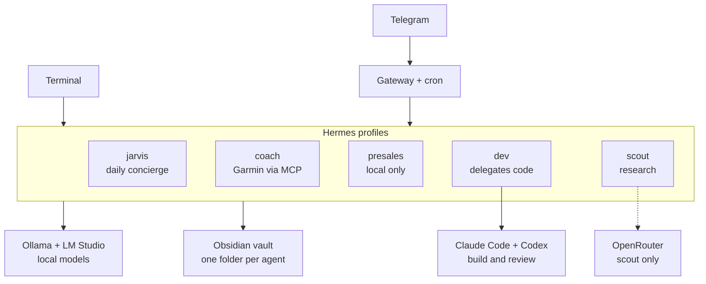

# Jarvis on Hermes

A local-first, multi-agent personal assistant built on [Hermes Agent](https://github.com/NousResearch/hermes-agent) (Nous Research), running on a MacBook Pro M5 Pro with local Ollama models, a shared Obsidian memory vault, and Claude Code + Codex as coding specialists.

> This repo holds the **design, templates and scripts** for the build. It contains no live agent memory, no secrets and no customer data. See [docs/SECURITY.md](docs/SECURITY.md).

## Why this exists

Most "AI OS" demos wire every agent to a cloud model, give them full disk and inbox access, and skip governance. This build takes the opposite stance:

- **Local brain by default.** Every agent thinks on local models via Ollama. Cloud is used only where it is explicitly allowed (research, coding delegation).
- **Separated agents.** Each agent is an isolated Hermes profile with its own identity, memory, skills and model.
- **Scoped, reviewable memory.** Agents write only to their own folder in a git-tracked Obsidian vault, so every memory change is a diff.
- **Security as a design goal.** Allowlisted messaging gateway, reviewed skills, sensitivity rules per agent, and a documented threat model.

## Architecture



Full detail: [docs/ARCHITECTURE.md](docs/ARCHITECTURE.md)

## Agents

| Agent | Job | Default model |
| --- | --- | --- |
| jarvis | Daily concierge: morning brief, reminders, notes, admin | Local workhorse |
| coach | Running and Hyrox coach reading Garmin data | Local workhorse |
| presales | PKI/CLM thinking partner, no customer documents | Local only, never cloud |
| scout | Research: AI security, PQC, competitors | Local, cloud for heavy research |
| dev | Build manager: Claude Code builds, Codex reviews | Local fast model |

Model choices: [docs/MODEL-MAP.md](docs/MODEL-MAP.md)

## Progress

| Phase | Scope | Status |
| --- | --- | --- |
| P0 | Mac prepared: Homebrew, Git, Python, Ollama, Obsidian, VS Code | ✅ Complete |
| P1 | Hermes installed, running on local models | ✅ Complete |
| P2 | Obsidian memory vault, scoped and git-backed | 🔄 In progress |
| P2B | Import project memory from existing Nexus RAG (sanitised export) | ⏳ Planned |
| P3 | Agent profiles with SOUL.md identities | ⏳ Planned |
| P4 | Skills and MCP tools (Garmin, reused Claude Code skills) | ⏳ Planned |
| P4B | Claude Code + Codex delegation and shared memory | ⏳ Planned |
| P5 | Telegram gateway and scheduled morning brief | ⏳ Planned |
| P6 | Security review, documentation, public release | 🔄 Ongoing |

## Repository layout

```
jarvis-hermes/
├── README.md
├── CLAUDE.md                 # Rules for Claude Code working in this repo
├── .env.example              # Placeholder variable names, no values
├── docs/
│   ├── ARCHITECTURE.md
│   ├── SECURITY.md           # Threat model and controls
│   ├── MODEL-MAP.md          # Which model does what, and why
│   └── DECISIONS.md          # Decision log
├── profiles/<agent>/
│   ├── SOUL.template.md      # Agent identity template (personal details removed)
│   └── config.example.yaml   # MCP / tool config examples with placeholders
├── vault-template/           # Empty Obsidian vault structure + seed note templates
├── scripts/
│   ├── check-no-secrets.sh   # Pre-commit secret and sensitive-term scan
│   └── vault-snapshot.sh     # Commit the vault so agent edits are reviewable
└── .github/workflows/
    └── secret-scan.yml       # gitleaks on every push
```

## Quick start (macOS)

Prerequisites: Homebrew, Git, Ollama with at least one local model, Obsidian.

```bash
# 1. Install Hermes (read the script first)
curl -fsSL https://hermes-agent.nousresearch.com/install.sh -o ~/Downloads/hermes-install.sh
less ~/Downloads/hermes-install.sh
bash ~/Downloads/hermes-install.sh

# 2. Point it at local models: choose "Local models" in the wizard
hermes setup
hermes model
hermes doctor

# 3. Create the vault from the template
cp -R vault-template ~/JarvisVault
cd ~/JarvisVault && git init && git add . && git commit -m "Vault created"
```

Then follow the phases above. Windows setup (PowerShell installer) is planned but not yet tested.

## Security

Read [docs/SECURITY.md](docs/SECURITY.md) before running anything here. In short: secrets live only in `.env` files, the Telegram gateway is allowlisted to one user ID, no customer material enters the vault or any cloud model, and every third-party skill is read before it is installed.

## Disclaimer

Independent personal project. Not affiliated with Nous Research, Anthropic, OpenAI or any employer. No customer or employer data is stored in this repository.

## License

MIT, see [LICENSE](LICENSE).
