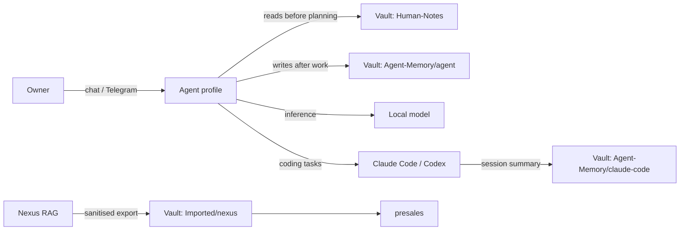

# Architecture

## Components

| Layer | Component | Role |
| --- | --- | --- |
| Interfaces | Terminal (`<profile> chat`), Telegram | How the owner talks to agents |
| Runtime | Hermes Agent | Agent loop, tools, skills, memory, profiles, gateway, cron, kanban |
| Agents | Hermes profiles: jarvis, coach, presales, scout, dev | Isolated identities, each with its own SOUL.md, memory, skills and model |
| Models | Ollama, LM Studio (local); OpenRouter (cloud, scout only) | Inference |
| Memory, hot | Hermes built-in memory (MEMORY.md, USER.md per profile) | Agent working memory |
| Memory, cold | Obsidian vault, git-tracked | Long-term, human-reviewable memory shared across agents and tools |
| Specialists | Claude Code (build), Codex (review) | Called by dev through Hermes skills |
| Tools | MCP servers (Garmin) | External data access |

## Data flow



## Vault layout

```
JarvisVault/
├── Human-Notes/          # Written by the owner. Agents read, never edit.
├── Agent-Memory/
│   ├── jarvis/
│   ├── coach/
│   ├── presales/
│   ├── scout/
│   ├── dev/
│   ├── claude-code/      # Session summaries from Claude Code
│   └── codex/            # Session summaries from Codex
└── Imported/
    └── nexus/            # Regenerated by the export script, never hand-edited
```

## Design principles

1. **Lowest rung first.** Prefer a skill on an existing agent over a new agent. New profiles only at trust boundaries (different data, different model permissions).
2. **Model per agent, not per message.** Routing is fixed by profile, which makes cost and data exposure predictable.
3. **Memory is a diff.** Every agent write to the vault is reviewable with `git diff`.
4. **Cloud is opt-in per agent.** Only scout (research) and dev's delegated coding tools reach the cloud.
5. **Human gate on side effects.** No sending, purchasing, pushing or deleting without explicit approval.

## Multi-agent coordination

- **Simple:** talk to each profile directly (`coach chat`).
- **Scheduled:** cron jobs run by the gateway, delivered to Telegram.
- **Pipelines:** Hermes kanban board, where tasks are assigned to profiles and the dispatcher runs them in dependency order. Used later for the proposal pipeline (writer, designer, checker).
